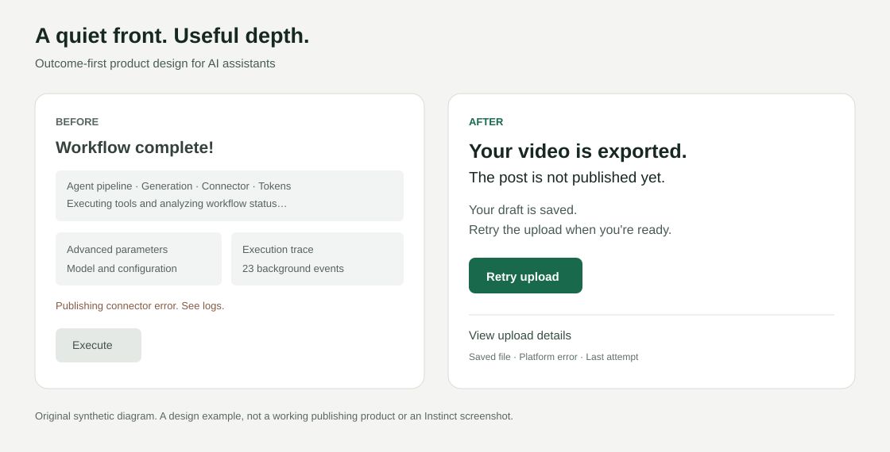

# Instinct design

用 Instinct 启发的产品设计哲学，优化你自己的产品。带来页面、流程、需求文档或代码，得到具体改进和可检查的结果。

默认从你的用户任务出发，找问题、做改进、验证，再根据真实反馈迭代。结论先行、说人话、前台极简、深度按需展开是设计依据，Instinct 研究资料按需读取。

[试用中文入口](https://friedrich-arthur.github.io/instinct-design/zh/) · [English](README.md) · [中文深拆与实战指南](https://friedrich-arthur.github.io/instinct-design/zh/guide/) · [设计文档](docs/design.zh-CN.md)

> **改前：**“工作流已全部完成！发布连接器发生错误，请查看日志。”
>
> **改后：**“视频已导出，但还没发布。草稿已保存，需要时可以重试上传。”



## 安装

```sh
npx skills add Friedrich-arthur/instinct-design --skill instinct-design
```

在 CLI 中选择代理和安装范围。也可以把完整的 `skills/instinct-design` 文件夹复制到代理支持的技能目录。不要只复制 `SKILL.md`，否则会丢失按需参考。采用标准 [Agent Skills 格式](https://agentskills.io/specification)，具体客户端支持以实际安装和加载结果为准。

## 使用

```text
用 $instinct-design 优化这个产品。
检查我提供的页面、流程、需求文档或代码，找出最影响用户任务的问题。
用相关产品设计原则改好它，交付具体改稿或实现。
保留现有设计系统、专家信息需求和关键限制。
说明改前改后的差别与验证方法；需要且已授权实现时直接修改。
```

下一轮带上前一版产物和真实反馈或失败，它会围绕同一个任务继续修正。只改一句消息时，直接给可用消息；设计界面时给具体布局，需要实现时修改实际产品。输出沿用当前任务语言。

## 设计方法

- 结论先行，首句说明真实结果或当前状态。
- 说人话，用用户的对象和动作解释事情。
- 前台极简，把当前任务和主动作放清楚。
- 后台能力按需展开，理由、证据、备选和高级控制可发现、可返回。
- 保持可预测，费用、授权、失败和关键不确定性始终可见。
- 少打扰，只在用户现在需要行动且等待有后果时提醒。
- 美感服务于理解，层级、留白、字体与动效保持一致。

核心指令保持短小；10 个参考覆盖产品优化、中英文 Instinct 深拆、练习、产品理念、消息、交互、美感、评审与来源，按需读取。

## 先改一个真实任务

[优化方法](skills/instinct-design/references/product-optimization.md)把实际问题与适用原则、具体改动、同一任务的检查连起来。保留有效行为与专家需要的信息密度。默认交付你的产品改进，研究拆解在需要时才展开。

[完整迭代示例](examples/04-product-iteration.md)展示导入页如何改正误导状态、明确恢复动作，再用反馈决定下一次小修正。

## 从兴趣走到具体借鉴

[中文深拆](skills/instinct-design/references/instinct-teardown.zh-CN.md)借鉴 Reverse Engineer Anything 的证据思路，每个模式都给依据、机制假说、迁移方式、适用边界和检查方法。包含可以直接填写的借鉴卡，以及专家工作台不宜改成聊天的反例。

[练习](skills/instinct-design/references/pattern-lab.md) 覆盖部分完成的任务、断开账号后的分项回执，以及通知选择。先选一个真实问题，直接做出可以评审的设计结果。

## 看具体变化

| 示例 | 变化 |
| --- | --- |
| [助理消息](examples/01-assistant-message.md) | 推荐结果和运费缺口先出现 |
| [结果界面](examples/02-result-screen.md) | 主决策、原始证据和回复编辑分层 |
| [失败与打扰](examples/03-failure-and-attention.md) | 部分成功如实报告，通知跟随用户后果 |

所有案例为合成示例，不是客户成绩或 Instinct 实际产品截图。

## 验证与贡献

提供 [5 个行为试用请求](evals/cases.json)，包含已有授权和极简隐藏付款风险等边界。实际检查范围见 [验证记录](evals/README.md)。格式通过不等于真实用户效果。

遇到失效时，用脱敏任务、实际输出和用户后果提交 Issue。贡献优先补一个可复现失败对应的小修正；不要上传私人资料、完整转写、凭据或无权公开的截图。

维护者可以按[贡献指南](CONTRIBUTING.md)复跑包检查和文章生成检查。

[优化与增长计划](docs/growth-plan.md) 链接 6 个可执行任务。[传播包](docs/launch-kit.md) 给渠道文案、分享素材和目录条目；准备、发布、收录、采用与 Star 分别确认。

## 来源与边界

独立、非官方。受 [Instinct 公开产品介绍](https://instinct.com/) 和访谈笔记启发。“结论先行、说人话、前台极简、后台按需展开”是作者提炼，美感建议是原创应用，均不冒充 Instinct 官方设计规范。详情见 [来源说明](skills/instinct-design/references/sources.md)。

本 Skill 指导助手优化产品，也可修改已授权代码。实际执行与权限取决于宿主环境，业务记忆、账号集成、持久化和自主行动仍需实现与验证。仓库原创材料采用 MIT；第三方品牌和链接材料保留原权利。
